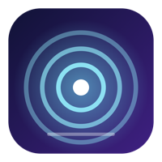

<p align="center"></p>

<h1 align="center">LG Smart Touch Enabler</h1>

<p align="center">
  <a href="https://github.com/alexeinz/lgsmart_touch_enabler/actions/workflows/ci.yml"></a>
  <a href="https://github.com/alexeinz/lgsmart_touch_enabler/releases/latest"></a>
  
  
</p>

<p align="center"><b>Make the touchscreen on your LG Smart Monitor Swing work on a Mac.</b><br>Tap, drag, scroll with momentum, pinch, right-click, multi-finger shortcuts and edge swipes, from a menu-bar app.</p>

## Download

Grab the latest `.dmg` from the [Releases page](https://github.com/alexeinz/lgsmart_touch_enabler/releases/latest), drag the app to Applications, then grant **Accessibility** and **Input Monitoring** in the Permissions tab. The build is not notarized, so the first time use right-click > Open. Releases after v2.1.0 are signed with one stable self-signed certificate, so permissions survive updates; coming from v2.1.0 or earlier you grant them one last time (see Troubleshooting if stale entries linger).

A userspace touch driver for macOS. It makes the touchscreen on the **LG 31.5" 4K Smart Monitor Swing** (MFTouch HID digitizer, `VID 0x284B / PID 0x8300`) work as a real touch input, which macOS does not support natively. It ships a menu-bar settings app and a headless daemon.

- Tap = click, drag = drag, hold = right-click, double-tap = double-click
- Two-finger drag = scroll (with momentum after a flick), two-finger tap = right-click, two-finger pinch = zoom
- Optional two-finger flick (Back/Forward) and two-finger double-tap (smart zoom) bindings
- Settings → Test tab can **record a touch trace** (also `touchd record`) for replaying in tests
- 3/4/5-finger swipes and 4-finger pinch fire **configurable keyboard shortcuts**
- Optional **native gestures** (Settings → General, experimental): pinch and two-finger twist are sent as real trackpad zoom / rotate events, and 3 to 5 finger swipes drive Spaces and Mission Control so they follow the fingers. Off by default; the keyboard shortcuts remain the fallback
- **Calibration** (Settings → General → Calibrate…): touch five targets and the app fits a correction for offset, scale, skew, mirroring and rotation
- Up to 10 simultaneous contacts are tracked
- **Touch helpers** (Settings → Windows): tap magnet that snaps to small buttons, finger ripples, triple-tap selects a line, hold-then-drag selects text, snap/tile windows by dragging a title bar to an edge or corner (double-tap a title bar to maximize), optional edge/corner grab-to-resize and three-finger window drag. These use the Accessibility API and are **not yet verified on the real monitor**
- Optional **edge swipes**: one finger from a screen edge inward fires a shortcut (off by default)
- Settings app: shortcuts, sensitivity, display and rotation, launch at login
- **Test** tab: live view of every contact, **Logs** tab, and a **Monitor** tab (input switch, resolution, volume)
- Config is one JSON file, live-reloaded by the daemon

> **Status:** single-touch and two-finger scroll are confirmed on hardware. Multi-finger gestures (pinch, 3/4/5-finger swipes) are covered by unit tests but **not yet verified on the real monitor**. Expect to tweak sensitivity. Native gestures and the calibration screen are new and **untested on the real monitor**; native gestures rely on undocumented event fields, and the Spaces / Mission Control swipe in particular may not work or may run in the wrong direction on your macOS version.

## Requirements

- macOS 13 or later (developed on macOS 27, Apple silicon)
- Swift 5.9+ toolchain (Command Line Tools are enough; Xcode is not required)

## Install

### Option A: menu-bar app (recommended)

```bash
./scripts/build-app.sh
cp -R "build/LG Smart Touch Enabler.app" /Applications/
open "/Applications/LG Smart Touch Enabler.app"
```

Or build a drag-to-install disk image with `./scripts/make-dmg.sh` (`build/LG-Smart-Touch-Enabler-<version>.dmg`; ad-hoc signed, not notarized).

Open **Settings…** from the menu-bar icon, then:

1. **Permissions** tab: grant **Accessibility** and **Input Monitoring**.
2. **General** tab: turn on **Launch at login**.

macOS ties permissions to the code signature, and ad-hoc signing changes it every build. Run this once to create a stable self-signed certificate; `build-app.sh` then uses it automatically and your grants survive rebuilds:

```bash
./scripts/setup-signing.sh
```

Or sign with your own identity: `CODESIGN_IDENTITY="Apple Development: you@example.com (TEAMID)" ./scripts/build-app.sh`.

### Option B: headless daemon

```bash
./scripts/install-launchagent.sh install     # installs ~/.local/bin/touchd + LaunchAgent com.touchd.daemon
./scripts/install-launchagent.sh uninstall
```

Grant Accessibility and Input Monitoring to `~/.local/bin/touchd` in System Settings → Privacy & Security.

Run only one of the app or the daemon at a time, since both would inject events.

## Default gestures

| Gesture | Default action |
|---|---|
| 1 finger tap / drag / hold | click / drag / right-click |
| 2 fingers drag | scroll (natural direction, invertible), coasts after a flick |
| 2 fingers quick tap | right-click |
| 2 fingers quick flick left / right | off by default; bind to ⌘[ / ⌘] for browser Back / Forward |
| 2 fingers swipe in from right edge | off by default; bind to a Notification Center shortcut |
| 2 fingers hold still (0.6 s) | off by default; bind to an on-screen keyboard shortcut |
| 3 fingers quick tap | Look Up (⌃⌘D), rebindable |
| 2 fingers double-tap | off by default; bind to a smart-zoom shortcut (a single tap then waits briefly before right-clicking) |
| 2 fingers pinch in / out | ⌘− / ⌘= (zoom), or a real zoom gesture with native gestures on |
| 2 fingers twist | rotate gesture (native gestures only) |
| 3, 4 or 5 fingers swipe left / right | ⌃→ / ⌃← (next / previous Space) |
| 3, 4 or 5 fingers swipe up | ⌃↑ (Mission Control) |
| 3, 4 or 5 fingers swipe down | ⌃↓ (App Exposé) |
| 3, 4 or 5 fingers swipe, native swipes on | Spaces / Mission Control follow the fingers (experimental; replaces the four rows above) |
| 4 fingers pinch in / out | F4 / F11 (Launchpad / Show Desktop) |
| 1 finger on a title bar, dragged to a screen edge or corner | snap to half / quarter / maximize |
| 1 finger double-tap on a title bar | maximize / restore |
| 1 finger triple-tap | select line (3 clicks) |
| 1 finger hold on a window edge, then drag | resize (off by default) |
| 3 fingers on a window, drag | move the window (off by default; replaces the 3-finger swipes) |
| 1 finger from left / right / top / bottom edge | disabled until you bind a shortcut |

Every binding can be re-recorded, chosen from presets, or disabled in **Settings → Gestures**.

**Mission Control caveat:** the Space and Mission Control defaults are the standard macOS shortcuts. Enable them in System Settings → Keyboard → Keyboard Shortcuts → Mission Control, or the gestures will do nothing.

## Monitor controls

The **Monitor** tab changes resolution and volume, and switches the monitor input over DDC/CI (Apple silicon, private IOAVService). Input codes are the standard MCCS values. **Not working on the test Mac yet:** `touchd ddc` finds the external display but the I2C write is rejected (IOKit error 0xe0114000), so input switching is unverified. Check that DDC/CI is enabled in the monitor's own menu, and try a different cable or port (set `TOUCHD_DDC_DEBUG=1` for raw output). HDMI/DisplayPort audio often has no software volume.

## Hardware limits

The digitizer reports only tip switch, contact ID and X/Y. There is no pressure or contact size, so pressure sensitivity and palm rejection are not possible.

## CLI

```bash
touchd run             # run the daemon in the foreground
touchd status          # permissions, device, display
touchd ddc             # probe the monitor over DDC/CI
touchd dump            # print raw HID reports (debugging)
touchd config path     # location of the config file
touchd config print
touchd config reset
```

## Configuration

`~/Library/Application Support/touchd/config.json`, written by the app and watched by the daemon (about 1 s poll). A corrupt file is moved to `config.json.bad` and defaults are used. Missing keys fall back to defaults, so hand-editing is safe.

## Layout

```
Sources/TouchCore/    gesture engine, config, HID source, CG event output (library, unit-tested)
Sources/touchd/       CLI daemon
Sources/TouchdApp/    SwiftUI menu-bar settings app
Tests/TouchCoreTests/ Swift Testing suite (104 tests)
scripts/              build-app.sh, setup-signing.sh, make-dmg.sh, install-launchagent.sh, test.sh
legacy/               original single-file prototypes, kept for reference
```

The engine talks to the OS only through the `EventSink` protocol and injected clock/scheduler, so gesture logic is tested without hardware or permissions.

## Development

```bash
swift build
./scripts/test.sh    # adds the Swift Testing search paths needed with Command Line Tools only
```

## Troubleshooting

- **Nothing happens on touch:** run `touchd status` or check the Permissions tab. Both Accessibility and Input Monitoring are required.
- **After a rebuild permissions stopped working:** run `./scripts/setup-signing.sh` once, rebuild, and grant permissions again (the first time only). If the app is missing from Input Monitoring, run `tccutil reset ListenEvent com.touchd.app` and relaunch.
- **After an update the toggles are on but the app says "Missing":** the entries belong to an older, differently signed build. Click **Reset Permissions…** in the Permissions tab (or run `tccutil reset Accessibility com.touchd.app` and `tccutil reset ListenEvent com.touchd.app`), then grant again after the relaunch.
- **Uninstalling:** use **Uninstall…** in the Permissions tab. It removes the login item and both permissions, then moves the app to the Trash. macOS keeps the permissions if you only drag the app to the Trash; the two `tccutil` commands above clean up afterwards. The config file is left in place.
- **Touch lands on the wrong display or is rotated:** pick the display and rotation in Settings → General.
- **Touch is offset, scaled or mirrored:** run **Calibrate…** in Settings → General and touch the five targets with one finger (Esc or a mouse click cancels). The result replaces the rotation setting; **Clear calibration** goes back to it. Calibration is rejected if a target was missed.
- **Native gestures misbehave:** turn them off in Settings → General to return to keyboard shortcuts.
- **Swipes do nothing:** see the Mission Control caveat above.
- **Different monitor:** see [Adding another touch screen](docs/ADDING_SCREENS.md) (find the VID/PID, verify with `touchd dump`, map display and rotation).

## License

MIT
